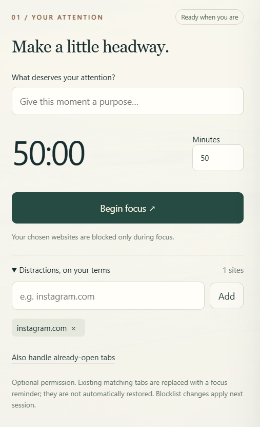
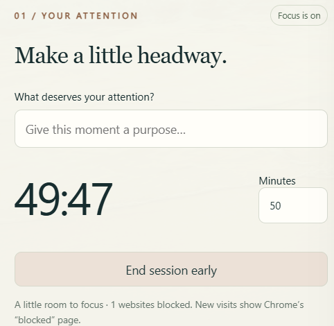
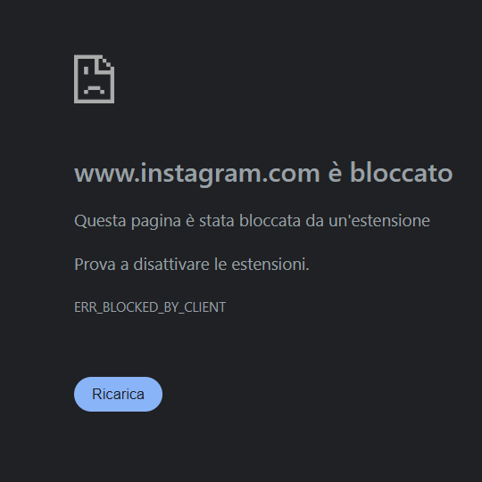
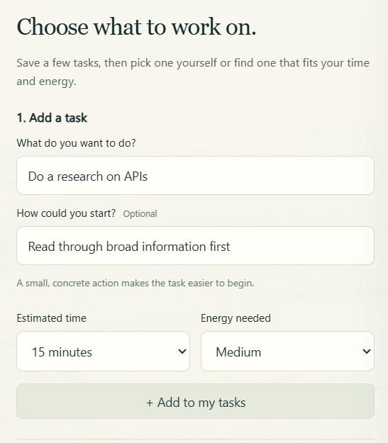
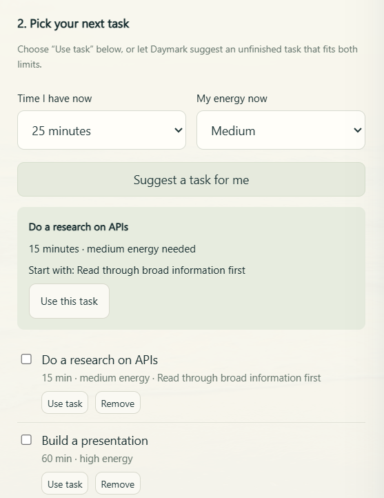
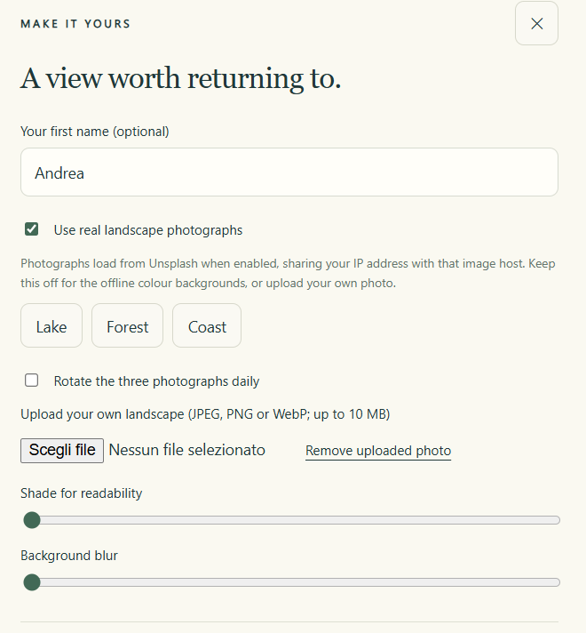
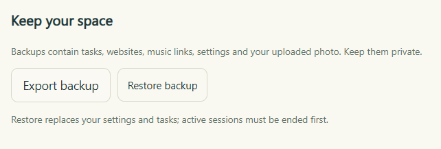

# Daymark

**A quieter new tab. A clearer next step.**

Daymark is a Manifest V3 Chrome extension inspired by the personalised new-tab category, with an original focus on choosing a manageable task, starting with a small step, and leaving a breadcrumb for next time. Working name; not affiliated with Momentum, Spotify, Apple or Unsplash.

**Version 0.1.1 · Install locally in Chrome.** No account, server, API key or build step required. Not published to the Chrome Web Store.

[Source repository](https://github.com/andpet03/daymark-extension) · [Verification evidence](docs/TESTING.md) · [Publication audit](AUDIT.md)

The owner tested the extension in Chrome and confirmed website blocking and release, audio continuing after the dashboard closes, saved data after reload, and backup restoration. Nine automated logic/mocked-worker tests passed during development. These are separate kinds of evidence; see the verification notes for their limits.

## A look inside

### Focus on one thing

Choose a duration and websites to block. During focus, new visits to a blocked site show Chrome's blocked-request page.




<details>
<summary>See the blocked website</summary>



</details>

### Find a task that fits

Save estimated time and required energy, then choose a task yourself or request a suggestion. Selecting it fills the focus panel; starting the timer remains a separate action.




### Make the space yours

Choose optional landscape photos, upload an image, and adjust shade and blur. Save a private backup when needed.





More screenshots document the [backup restoration check](docs/TESTING.md#backup-restoration-evidence).

## Purpose and interaction

- Replace Chrome's New Tab page with a clock, personal greeting and focus dashboard.
- Run 1–180 minute sessions with a user-defined website blocklist. Domains include their subdomains. URLs are reduced to whole domains, not individual paths.
- Optionally grant access to tab URLs to replace already-open matching tabs with a focus reminder when starting a session. Otherwise only subsequent network navigations are blocked.
- Add tasks with their estimated time and required energy. Use the explicitly labelled current time/energy controls to request a suggestion, then click Use this task to fill the focus panel without starting its timer; record a small first step, mark tasks done and leave a return note.
- Play a mix of generated brown noise, rain-like noise and ocean-like waves. Audio runs in an offscreen document so it can continue after the dashboard closes. It stops when the session ends or is ended early; standalone playback continues until stopped or Chrome closes.
- Apply three starter scenes or save up to ten personal scenes with their own domain list, sound levels, timer and landscape choice.
- Save up to twenty Spotify or Apple Music links. These open the music service in a new tab. **No account integration, in-app streaming or music playback control.** A music domain on the focus blocklist will also be blocked.
- Choose optional real landscape photos, a daily rotation, a personal uploaded photo, shade and blur. Default colour backgrounds work offline. Uploaded photos override the selected landscape globally, including across scenes.
- Export and restore a private JSON backup. Restore replaces existing settings and tasks and is refused during an active session.

## Setup — no build or API keys

1. On the [repository page](https://github.com/andpet03/daymark-extension), choose **Code → Download ZIP**, then extract it to a permanent folder.
2. In Chrome, open `chrome://extensions`.
3. Turn on **Developer mode**.
4. Click **Load unpacked** and select the extracted folder containing `manifest.json`—usually **daymark-extension-main** for a GitHub download, or **daymark** for the supplied project ZIP. Do not select `assets`, `docs` or `tests`. The folder picker hides files; seeing only those subfolders is normal.
5. Open a new tab and accept Chrome's new-tab change if prompted.
6. Start with the [verification checklist](docs/TESTING.md). Pin Daymark's toolbar icon if useful; clicking it opens the dashboard.

Installation needs Chrome 116 or later. There are no runtime dependencies and no server. Do not run this through Python's HTTP server: website blocking and storage need the extension context. A normal web preview is read-only.

To update later: keep the same folder, replace its source files and click **Reload** on Daymark in `chrome://extensions`. Keep the folder on disk. End sessions first. Export a backup before moving the folder or uninstalling: a changed extension ID or uninstall can make local settings unavailable.

### Tests (optional, for development)

With Node.js 22 or later, from the project folder:

```powershell
node --test tests/*.test.js
```

Tests use Node's built-in test runner; no `npm install` is required. The mocked Chrome API tests are not evidence that real browser APIs work.

## Data collection

No accounts, analytics, browsing history collection, remote code, or backend. Tasks, names, URLs, sound preferences and uploaded photos are entered by the user. The clock uses the device time.

Optional landscape photographs are requested directly from `images.unsplash.com`. Enabling them exposes ordinary network metadata such as the user's IP address to that host. Photos are off by default. Failed photo requests leave a colour background. See [image and sound sources](docs/ATTRIBUTION.md).

Music links are only opened at the user's request. Their services have their own accounts, subscriptions and privacy practices.

## Data persistence

`chrome.storage.local` holds one validated settings object and the active session deadline. Settings include tasks, first steps, breadcrumb, domain lists, music links, personal scenes, completed-session count and appearance. A user image is resized to at most 1920×1080, JPEG-encoded and stored locally; raw image metadata is not deliberately retained.

`chrome.storage.session` records transient audio state. Network blocking uses session rules; the background worker reconstructs them from the persistent deadline on browser startup. A Chrome alarm expires the session; the dashboard also requests reconciliation when reopened. Sleeping devices can delay alarm execution until wake-up. Audio does not automatically resume after a browser restart.

Backups include settings and an uploaded photo, but not an active focus session. They may contain private tasks and URLs; `.gitignore` excludes the default backup filename. No cross-device sync. Multiple dashboard tabs share stored state; concurrent edits to the same list can overwrite one another, so use one dashboard for editing.

## Permissions and blocking boundaries

| Permission | Reason |
| --- | --- |
| `storage` | Save settings and focus state on this device. |
| `alarms` | End focus even when the dashboard is closed. |
| `declarativeNetRequest` | Block top-level requests to selected websites during focus. |
| `offscreen` | Continue generated audio when the dashboard tab closes. |
| `tabs` — optional | Read existing tab URLs only to replace matching tabs at session start. |

There is no all-sites host permission, content injection, history or microphone permission. New blocked visits show Chrome's generic blocked-request page. Already-open tabs can show our reminder only after the optional tabs permission is granted. Previously cached pages, browser-internal pages, other browsers/profiles, incognito where not enabled, and already-running page content are outside the guarantee. This is a voluntary focus aid, not parental control or a security boundary. You can always end the session or disable the extension.

If a site seems blocked after a session: return to Daymark to reconcile state, then reload the site. If necessary, disable the extension from `chrome://extensions`.

## Learning and development process

The user defined the desired focus blocker, ambient sound/music choices and custom backgrounds. The initial implementation separates pure validation/recommendation logic (`core.js`), the interface (`app.js`), persistent focus operations (`background.js`) and audio (`audio.js`). This supports testing without depending on a running browser.

One challenge is that Manifest V3 workers can stop between events. The design stores a deadline instead of trusting a JavaScript countdown, uses Chrome alarms, and rebuilds rules on startup. Another is avoiding claims of music-service integration when only opening a link: the interface explicitly labels that distinction.

The user’s browser test exposed a layout problem: “Add task” overflowed its card, and the purpose of the central panel was unclear. Version 0.1.1 replaced the cramped row with bounded fields and a full-width button, added visible labels and three numbered steps, and separated suggesting a task from choosing it and starting focus. The user then confirmed the revised layout was satisfactory and supplied screenshots.

This process demonstrated why passing logic tests does not establish that an interface is understandable or fits a real screen. Another lesson was to test persistence with an observable change: export, add a temporary task, restore, and check that only the temporary task disappears. These are documented project lessons, not an assertion of independent authorship; assistance is disclosed below. [Testing notes](docs/TESTING.md) distinguish automated checks, owner confirmations and remaining checks.

## Limitations and assistance

Built with substantial OpenAI Codex assistance for planning, source code, generated sound algorithms, icon, documentation and tests. Official Chrome documentation informed the extension architecture. No code was copied from Momentum. Landscape URLs reference Unsplash; licensing and unverified photographer details are recorded separately.

The audio is synthetic, not a library of recorded forests, cafés or fireplaces. No promise of increased concentration. Sound levels and comfort are personal. Other proposed features not included yet: unlimited sessions, scheduled blocking, full streaming-account connections, animated progress landscapes, theme switching, cloud sync and a complete end-of-day ritual.

The owner’s Chrome checks and screenshots are included. The [local publication audit](AUDIT.md) records findings, documentation fixes and remaining limitations. Repository upload and Git history have not been independently verified. Restart recovery, optional existing-tab handling, all photo presets, music links, saved scenes and a full accessibility review still need targeted browser checks. The course’s separate audit-evidence PDF is not part of this repository package.

## Files

- `manifest.json`: Chrome configuration and permissions.
- `index.html`, `style.css`, `app.js`: dashboard.
- `core.js`: input validation, domain matching, rules, recommendations and backup validation.
- `background.js`: session lifecycle, rules, storage and audio coordination.
- `audio.html`, `audio.js`: locally generated offscreen audio.
- `blocked.html`: reminder for already-open matching tabs.
- `tests/`: dependency-free logic and mocked lifecycle tests.
- `docs/`: verification and attribution notes.
