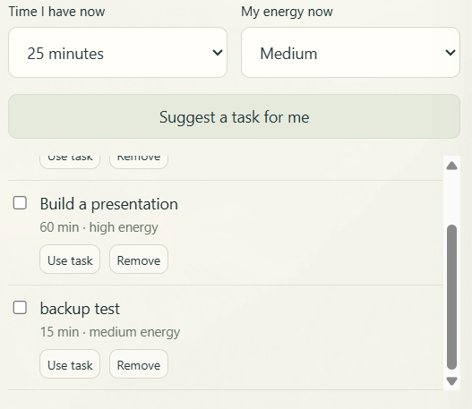
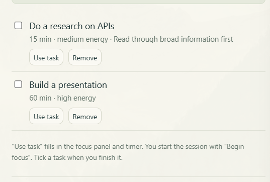

# First-build verification

Prepared 25 November 2026. Development checks and owner browser evidence. For the separate publication review, see [AUDIT.md](../AUDIT.md).

## Checks completed in the coding environment

- 9 Node test cases passed: domain normalisation and rejection, subdomain boundaries, top-level-only block rules, allowed music URLs, time/energy task matching, deadline arithmetic, backup validation and a mocked worker lifecycle.
- Worker scenario covers starting, rejecting a duplicate session, restoring lost session rules, preserving the session's original blocklist after settings edits, handling matching open tabs, stopping audio/rules/alarms, expiry counted once, and rollback after a simulated rules failure.
- JavaScript syntax checks passed.
- Manifest structure, referenced local files and HTML ID references checked statically.
- Browser execution was unavailable: Playwright had no installed browser and the system Chromium launcher pointed to a missing executable. No successful visual screenshot or real extension test is claimed.
- Direct fetching of the photograph host from this environment failed (403). The photo presets need checking in the user's Chrome. The offline colour/upload options do not depend on that host.

## Owner-reported Chrome results — 25 November 2026

The following results come from the owner’s screenshots and explicit confirmations in the project conversation. They are not independent browser runs by the assistant.

| Check | Evidence and status |
| --- | --- |
| Installation and dashboard display | Owner screenshots show the installed interface. |
| Corrected task-panel layout | Owner said the update was fine; screenshot shows Add to my tasks inside the panel. |
| Active timer and website blocking | Screenshots show a running timer and Chrome blocking Instagram. |
| Ending a session early releases the website | Owner confirmed the four-step focus/audio checklist completed. |
| Natural one-minute expiry releases the website | Owner confirmed the same checklist completed. |
| Sound sliders, tab switching, audio after closing dashboard, stopping on return | Owner confirmed the same checklist completed; screenshots cannot establish audio playback. |
| Task and return-note persistence after reload | Owner confirmed the subsequent persistence/backup checklist completed. |
| Chosen background persists after reload | Owner confirmed that checklist; it offered a preset OR uploaded photo, so upload specifically is not separately established. |
| Export and restore | Owner confirmation plus before/after task-list screenshots below. |

Still not separately verified in a real browser: browser restart during/after focus, optional already-open-tab handling, automatic sound stop at expiry, every sound combination, all three remote photo presets, uploaded-image handling specifically, saved-scene round trips, outbound music links, invalid-backup rejection/cancellation, simultaneous dashboards, full keyboard/zoom/accessibility coverage.

## Backup restoration evidence

The exported state contained the original tasks. A temporary “backup test” task was added and visible before restoration. After restoration, the screenshot shows the original tasks without that temporary entry, and the owner confirmed completion.

The private JSON backup is deliberately not included. The task-entry screenshot is also available as [backup-test-entry.png](screenshots/backup-test-entry.png).

## Repeatable Chrome checklist

1. **Installation:** load the folder containing `manifest.json`. Check that the extension card has no Errors button, open a new tab and confirm the dashboard appears.
2. **Safe blocking test:** add `example.com`. Set 1 minute and start focus. In another tab, visit `https://example.com`. Chrome should show its blocked-request page. End early, then reload that site; it should be available.
3. **Natural expiry:** repeat the 1-minute test, close the dashboard and wait for expiry. Reload the example site; it should no longer be blocked. Reopen Daymark and check the completed-session count increased once.
4. **Already-open tab test:** open `example.com` before starting. Grant the optional already-open-tabs permission. Start a session; that tab should become the Daymark reminder. End the session; revisit the original site yourself. The previous URL is not restored.
5. **Browser restart:** start a longer session and restart Chrome. Open Daymark; the original deadline should continue and the selected site remain blocked. End the session. Also test restarting after its deadline.
6. **Sounds:** select a modest volume and play the mix. Change its sliders. Close the dashboard; audio should continue. Reopen and stop it. Check that focus expiry and ending early stop audio. Verify actual sound quality; mocked tests cannot assess it.
7. **Tasks:** add a 5-minute low-energy task with a first step. Under Time I have now choose 15 minutes and under My energy now choose Low; Suggest a task for me should show it. Click Use this task: the focus panel should show the task, first step and a 5-minute timer. The timer should start only after Begin focus. Mark it done and confirm it is no longer suggested. Save a breadcrumb, click elsewhere and reload.
8. **Scenes:** save a personal scene with `example.com` and a chosen mix. Change the website list and apply the saved scene: the original list, timer and levels should return. Changing a scene during focus should be refused.
9. **Appearance:** open Make it yours, enable remote photos and check all three choices. Upload a local photo, change shade/blur and reload. Remove the upload to return to the chosen background. Confirm the dashboard remains readable.
10. **Music:** save a valid Spotify or Apple Music link. Confirm it opens the service. It is not an embedded player; no account connection should be implied.
11. **Backup:** export, add a disposable task, then restore the backup and confirm replacement. Refuse the confirmation once to verify cancellation. Keep the backup private and out of GitHub.
12. **Keyboard/sizing:** tab through controls, open/close settings with Escape, try a narrow window and browser zoom at 200%. Confirm readable text, focus indicators and no inaccessible controls.

Record actual results and screenshots before describing these as passed. Send the exact error text and which step failed if anything is wrong.

## v0.1.1 task-panel update

The user reported the Add task button overflowing its panel. Replaced the three-control flex row with two bounded grid fields and a full-width submit button. Added visible labels, numbered sections, explicit time/energy matching controls, a persistent suggestion result and a separate Use task action. Selection now saves the estimated duration and displays the first step in the focus panel. At narrow panel widths, fields stack. The owner subsequently confirmed the layout correction and supplied the screenshot included in the README. Automated logic tests and syntax/static reference checks passed during development; they were not rerun as part of the read-only publication audit.
